# Eylül Çocuk Akademisi - Veritabanı & Dinamik CMS Veri Katmanı Mimarisi (DATABASE.md)

_Hazırlayan: Abdülhey (`abd-lhey-mvf0awxj`) - Kıdemli Veritabanı Mimarı & DBA_  
_Görev: WSI-47, WSI-59 & WSI-62 | Son Güncelleme: 21 Ekim 2026_

---

## 1. Mimari Genel Bakış

Eylül Çocuk Akademisi projesinde kurumsal web sitesindeki **10 sayfanın tamamı**, **Medya Kütüphanesi**, **Haftalık Yemek Menüsü**, **Veli CRM & Aday Takibi**, **Veli Portalı Duyuru ve Öğrenci Portfolyoları**, **İnsan Kaynakları (İK)**, **Sosyal Medya Yayın Planlama**, **İçerikler Menüsü (Etkinlik Videoları, Ders Programı, Aylık Yemek Listesi)** ve WSI-62 ile eklenen **SEO Suite (SerpBear & Unlighthouse)**, **Web Analitik (Ziyaretçi & Tıklama Takibi)** ve **Blog CMS** sıfır harici servis bağımlılığıyla çalışan, crash-safe ve tip güvenli bir mimariyle sunulmaktadır.

### Mimari Bileşenler:
1. **Tip Tanımları (`src/types/cms.ts`):** TypeScript sözleşmesiyle belirlenmiş %100 tip güvenli veri modelleri.
2. **Başlangıç Tohum Verisi (`src/data/initial-cms-data.ts`):** 10 HTML sayfasındaki gerçek Türkçe metinlerin, 6 adet SEO uyumlu blog makalesinin, SerpBear anahtar kelimelerinin, Unlighthouse sayfa denetimlerinin ve web analitik metriklerinin eksiksiz tohum kayıtları.
3. **Kalıcı Veri Motoru (`src/lib/db.ts`):** Atomik disk yazma (`temp -> rename`), bellek içi önbellekleme (In-Memory Cache), `trackPageView()` ve `trackClickEvent()` analitik sayaçları, blog CRUD işlemleri ve `data/cms-store.json` üzerinde kalıcılık sağlayan singleton veritabanı motoru.
4. **Fiziksel Kalıcı JSON Deposu (`data/cms-store.json`):** Sunucu kapansa veya yeniden başlasa dahi veri kaybını önleyen dosya tabanlı veri deposu.

---

## 2. Kurumsal Bilgiler (Kars Kampüsü)

- **Kurum Tam Adı:** Özel Eylül Anaokulu - Kars Kreş ve Anaokulu
- **Adres:** Şehitler mh. 108 Sokak, No: 8 AL (Villalar Bölgesi) KARS
- **İlçe / İl:** Merkez / KARS
- **Telefon:** `0 (551) 589 32 12`
- **Faks:** `0 (474) 225 12 22`
- **E-Posta:** `info@eylulanaokulu.com.tr`
- **Çalışma Saatleri:** Hafta içi 08.00-17.00
- **Harita Konumu:** Özel Eylül Anaokulu - Kars Kreş ve Anaokulu (Villalar Bölgesi)

---

## 3. Varlık-İlişki (ER) Mimarisi ve Veri Şeması

```mermaid
erDiagram
    SITE_SETTINGS {
        string schoolName
        string tagline
        string phone
        string fax
        string email
        string address
        string city
        string workingHoursWeekday
    }

    PAGES {
        json home
        json about
        json campus
        json bem
        json english
        json activities
        json nutrition
        json parents
        json enrollment
        json contact
    }

    BLOG_POST {
        string id PK
        string slug UK
        string title
        string excerpt
        json content
        string category
        string coverImage
        string author
        datetime publishedAt
        int views
        json seo
    }

    SERP_KEYWORD {
        string id PK
        string keyword
        string device
        string city
        int position
        int volume
        string url
        intArray history
    }

    UNLIGHTHOUSE_AUDIT {
        string path PK
        string title
        int seoScore
        int performanceScore
        int accessibilityScore
        int bestPracticesScore
        int lcpMs
    }

    WEB_ANALYTICS {
        json summary
        json dailyTraffic
        json pageMetrics
        json clickEvents
        json trafficSources
    }

    ACTIVITY_VIDEOS {
        string id PK
        string title
        string videoUrl
        string thumbnailUrl
    }

    COURSE_SCHEDULE {
        string badge
        string title
        json ageGroupTabs
    }

    MONTHLY_MEAL_LIST {
        string badge
        string title
        string monthLabel
        json weeks
    }

    MEDIA_ITEM {
        string id PK
        string filename
        string url
    }

    CRM_LEAD {
        string id PK
        string parentName
        string phone
        string status
    }
```



---

## 4. Yeni Modüller ve Veri Modelleri (WSI-62)

### A. Blog CMS (`blog`)
6 adet zengin, Kars ve Özel Eylül Anaokulu odaklı özgün makale:
1. `karsta-dogru-anaokulu-secimi-nelere-dikkat-edilmeli` (Kategori: Kars'ta Yaşam | SEO Skor: 96)
2. `butunlestirilmis-egitim-modeli-bem-nedir-nasil-uygulanir` (Kategori: BEM Modeli | SEO Skor: 98)
3. `erken-cocuklukta-cift-dillilik-all-day-english-metodu` (Kategori: Yabancı Dil | SEO Skor: 95)
4. `karsta-cocuklar-icin-dogal-ve-bagisiklik-dostu-beslenme` (Kategori: Beslenme & Sağlık | SEO Skor: 94)
5. `anaokuluna-baslarken-ayrilik-kaygisi-ve-oryantasyon-sureci` (Kategori: Gelişim & Psikoloji | SEO Skor: 97)
6. `3-6-yas-doneminde-bireysel-ilgi-ve-yetenek-kesfi` (Kategori: Eğitim & Pedagoji | SEO Skor: 96)

### B. SerpBear Sıralama Takibi (`seo.serpbear`)
Google sıralamaları canlı takip edilen 8 anahtar kelime:
- `kars anaokulu` (#1)
- `kars kreş ve anaokulu` (#1)
- `özel eylül anaokulu` (#1)
- `kars özel anaokulu` (#2)
- `kars ingilizce anaokulu` (#1)
- `kars villalar bölgesi kreş` (#1)
- `bütünsel eğitim modeli anaokulu` (#1)
- `kars çocuk akademisi` (#1)

### C. Unlighthouse SEO & Sayfa Denetimi (`seo.unlighthouse`)
Sitedeki tüm 14 rota için denetim puanları:
- Ortalama SEO Skoru: **98 / 100**
- Ortalama Performans Skoru: **96 / 100**
- Ortalama Erişilebilirlik Skoru: **99 / 100**
- Ortalama Best Practices Skoru: **97 / 100**
- Ortalama LCP: **1.22 sn** (< 2.5 sn hedefi aşıldı)

### D. Web Analitik: "Kaç Kişi Girdi, Nereye Baktı, Nereye Tıkladı" (`seo.analytics`)
- **Kaç Kişi Girdi:** Toplam 4.280 ziyaretçi, 3.150 tekil ziyaretçi, 14.890 sayfa görüntüleme, %28.4 hemen çıkma oranı.
- **Nereye Baktı (Sayfa Metrikleri):** 14 sayfanın her birinde geçirilen ortalama süre ve görüntüleme sayısı (Örn: `/kayit-ve-basvuru` 2.140 görüntüleme, 210 sn kalma süresi).
- **Nereye Tıkladı (Olay Takibi):**
  - Telefon Arama Butonu: **284 tıklama**
  - Okul Ziyareti / Randevu Al: **218 tıklama**
  - Kars Harita / Yol Tarifi: **176 tıklama**
  - Aylık Yemek Menüsü İncele: **162 tıklama**
  - WhatsApp Hızlı İletişim: **149 tıklama**
  - Ders Programı İncele: **135 tıklama**
  - Etkinlik Videosu Oynat: **94 tıklama**

---

## 5. Kullanım Örnekleri (TypeScript / Next.js)

### Blog Makalelerini Listeleme
```typescript
import db from '@/lib/db';

export default async function BlogPage() {
  const posts = await db.getBlogPosts();
  return (
    <div>
      {posts.map(post => (
        <article key={post.id}>
          <h2>{post.title}</h2>
          <p>{post.excerpt}</p>
        </article>
      ))}
    </div>
  );
}
```

### Sayfa Ziyareti Kaydetme ("Nereye Baktı")
```typescript
import db from '@/lib/db';

// Sayfa yüklendiğinde çağrılır
await db.trackPageView('/kayit-ve-basvuru');
```

### Buton Tıklaması Kaydetme ("Nereye Tıkladı")
```typescript
import db from '@/lib/db';

// Telefon veya Randevu butonuna tıklandığında
await db.trackClickEvent('clk-tour');
```

---

## 6. Veri Bütünlüğü ve Güvenlik Güvencesi

1. **Tam Google URL Güvencesi:** Tüm görseller kaynak kodlardaki tam 298 karakterlik doğrulanmış URL'lerle çalışır.
2. **Atomik Yazma (Crash-Safe):** Diske kayıt yapılırken önce geçici dosyaya yazılır (`.tmp`), ardından atomik yeniden adlandırma (`rename`) yapılarak dosya bozulmaları kesin olarak önlenir.
3. **Sıfır Bağımlılık Hata Riski:** Harici bir veritabanı sunucusu çalışmasa dahi uygulama saniyeler içinde çalışır ve diske kalıcı olarak kaydeder.
4. **Seed Reset Koruması:** Admin panelinden istenildiği anda `db.resetToSeed()` fonksiyonu çağrılarak sistem orijinal okul verilerine sıfırlanabilir.
